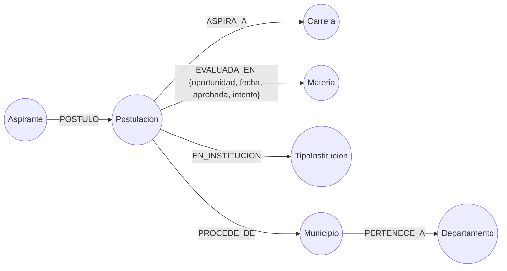

# Modelo de Neo4j

Versión 1 · 22 de octubre de 2026 · Depende de [reglas-etl.md](reglas-etl.md) y [modelo-mongodb.md](modelo-mongodb.md)

Neo4j guarda las **relaciones** entre aspirantes, carreras, materias, instituciones y lugares, y responde las
consultas de grafos y la exploración visual. MongoDB responde "cuántos" y "qué porcentaje"; Neo4j responde
"cómo se conectan".

## 1. Conceptos rápidos

| Término | Qué es | Ejemplo |
|---|---|---|
| **Nodo** | Una "cosa" del grafo | Un aspirante, una carrera |
| **Etiqueta** | El tipo de un nodo | `Aspirante`, `Carrera` |
| **Relación** | Una conexión **con tipo y dirección** entre dos nodos | `(aspirante)-[:POSTULO]->(postulación)` |
| **Propiedad** | Un dato guardado en un nodo o en una relación | `anio_ingreso: 2019` |
| **Cypher** | El lenguaje de consultas. Los patrones se dibujan con paréntesis (nodos) y corchetes (relaciones) | `(a:Aspirante)-[:POSTULO]->(p)` |
| **`MERGE`** | "Crea el nodo o la relación solo si no existe". Es lo que evita duplicados | |
| **Restricción de unicidad** | Impide que existan dos nodos de una etiqueta con el mismo valor de una propiedad | `Aspirante.id` único |

Dos particularidades de Neo4j que afectan al diseño: una propiedad con valor `null` **no se guarda** (simplemente
no existe), y una restricción de unicidad crea automáticamente un índice sobre esa propiedad.

## 2. Esquema



Lectura: una **persona** (`Aspirante`) tiene una **postulación** por cada año de ingreso en que se presentó. Cada
postulación apunta a la carrera (o carreras) a la que aspira, al municipio y tipo de institución de donde procede,
y a las materias en que fue evaluada.

## 3. Nodos

| Etiqueta | Cantidad | Clave única | Propiedades |
|---|---|---|---|
| `Aspirante` | 40,197 | `id` (el `aspirante_id` de 20 caracteres) | `sexo`, `anio_nacimiento` |
| `Postulacion` | 56,337 | `id` = `anio_ingreso\|aspirante_id` | `anio_ingreso`, `edad`, `zona`, `estado`, `aprobado`, `aprobo_ambas_en_el_anio`, `anio_habilitacion`, `n_evaluaciones` |
| `Carrera` | 14 | `nombre` | `nombre`, `ambigua` (solo en `INGENIERIA MECANICA (INDUSTRIAL O ELECTRICA, SIN PRECISAR)`) |
| `Materia` | 3 | `nombre` | `nombre` (`MATEMATICA`, `COMPUTACION`, `MATEMATICA ITUGS`) |
| `TipoInstitucion` | 4 | `nombre` | `nombre` (`PRIVADO`, `PUBLICO`, `POR COOPERATIVA`, `MUNICIPAL`) |
| `Departamento` | 23 | `nombre` | `nombre` (22 departamentos y `EXTRANJERO`) |
| `Municipio` | 253 | `id` = `DEPARTAMENTO\|MUNICIPIO` | `id`, `nombre`, `departamento` |

**Total: 96,831 nodos.** Las cantidades se midieron aplicando las reglas del ETL a los 10 CSV.

Los valores de `estado`, `aprobado`, `aprobo_ambas_en_el_anio` y `anio_habilitacion` en `Postulacion` son los
mismos que en la colección `postulaciones` de MongoDB (indicador principal y complementario de §10.3 de
reglas-etl). Si una postulación no tiene dato (por ejemplo, nunca se habilitó), la propiedad no existe.

## 4. Relaciones

| Relación | Cantidad | Propiedades | Notas |
|---|---|---|---|
| `(Aspirante)-[:POSTULO]->(Postulacion)` | 56,337 | — | Una por año de ingreso |
| `(Postulacion)-[:ASPIRA_A]->(Carrera)` | 56,228 | — | Una por carrera distinta (R-C8). No existe si la carrera es `null` (6,146 postulaciones sin carrera) |
| `(Postulacion)-[:EVALUADA_EN]->(Materia)` | 207,606 | `oportunidad`, `fecha`, `aprobada`, `intento`, `carrera` | **Una por evaluación.** Puede haber varias entre la misma postulación y materia, distinguidas por `oportunidad` |
| `(Postulacion)-[:PROCEDE_DE]->(Municipio)` | 55,138 | — | No existe si la institución es `SIN DATOS` |
| `(Postulacion)-[:EN_INSTITUCION]->(TipoInstitucion)` | 55,138 | — | Igual |
| `(Municipio)-[:PERTENECE_A]->(Departamento)` | 253 | — | Jerarquía geográfica |

**Total: 430,700 relaciones.**

## 5. Decisiones de diseño

**5.1 Un nodo `Postulacion` entre la persona y todo lo demás.** Casi todo lo que se quiere analizar cambia de un
año a otro: la carrera, la edad y el estado de aprobación. Si esos datos colgaran directamente del aspirante,
habría que repetir el año en cada relación. Con la postulación como nodo intermedio, el año es una propiedad,
filtrar por año es una condición simple y se puede recorrer la historia de una persona de un año al siguiente
(`Aspirante → Postulacion 2018 → Postulacion 2019`). Es la misma idea que la colección `postulaciones` de MongoDB.

**5.2 Cada evaluación es una *relación* con propiedades, no un nodo.** Una evaluación solo conecta una
postulación con una materia y no tiene nada más colgando de ella. Crear 207,606 nodos extra recargaría el grafo y la
visualización sin aportar nada. Como pueden existir varias relaciones iguales entre la misma postulación y la
misma materia (los reintentos), `oportunidad` es lo que las distingue: `MERGE` usa esa propiedad como clave, así que
recargar el mismo archivo no duplica nada.

**5.3 La geografía es una jerarquía `Departamento ← Municipio`.** Hay nombres de municipio repetidos en
departamentos distintos (`SAN JOSE`, `SANTA LUCIA`, `SAN ANDRES`…), por lo que el municipio se identifica con un
`id` compuesto `DEPARTAMENTO|MUNICIPIO`. Así basta una restricción de unicidad de una sola propiedad, y no se
mezclan municipios de distintos departamentos. La capital queda como el municipio `GUATEMALA`; su `zona` es una
propiedad de la postulación (solo existe de 2015 a 2021, R-G4).

**5.4 El año de ingreso es una propiedad, no un nodo.** Un nodo `Anio` tendría hasta ~6,900 relaciones (un
"súper nodo"), que ralentizan los recorridos y ensucian la visualización.

**5.5 Un dato ausente no genera relación.** `NINGUNO`, `SIN DATOS` y los valores nulos no crean nodos
"vacíos" que mezclarían miles de aspirantes sin relación real entre sí.

**5.6 Cero duplicados por construcción.** Cada etiqueta tiene una clave única con restricción (§6), y toda la carga
usa `MERGE` sobre esa clave.

## 6. Restricciones e índices

```cypher
CREATE CONSTRAINT aspirante_id      IF NOT EXISTS FOR (a:Aspirante)       REQUIRE a.id IS UNIQUE;
CREATE CONSTRAINT postulacion_id    IF NOT EXISTS FOR (p:Postulacion)     REQUIRE p.id IS UNIQUE;
CREATE CONSTRAINT carrera_nombre    IF NOT EXISTS FOR (c:Carrera)         REQUIRE c.nombre IS UNIQUE;
CREATE CONSTRAINT materia_nombre    IF NOT EXISTS FOR (m:Materia)         REQUIRE m.nombre IS UNIQUE;
CREATE CONSTRAINT tipo_nombre       IF NOT EXISTS FOR (t:TipoInstitucion) REQUIRE t.nombre IS UNIQUE;
CREATE CONSTRAINT departamento_nom  IF NOT EXISTS FOR (d:Departamento)    REQUIRE d.nombre IS UNIQUE;
CREATE CONSTRAINT municipio_id      IF NOT EXISTS FOR (m:Municipio)       REQUIRE m.id IS UNIQUE;

CREATE INDEX postulacion_anio IF NOT EXISTS FOR (p:Postulacion) ON (p.anio_ingreso);
CREATE INDEX postulacion_aprobado IF NOT EXISTS FOR (p:Postulacion) ON (p.aprobado);
```

Las siete restricciones crean sus propios índices. Los dos índices adicionales sirven para los filtros por año y por
estado de aprobación del explorador de grafos.

## 7. Cómo se carga

Neo4j se llena **después** de MongoDB, leyendo las colecciones derivadas (`postulaciones` y `evaluaciones`), de modo
que ambos motores comparten exactamente los mismos estados de aprobación. Todo es idempotente: se puede ejecutar
las veces que haga falta.

| Paso | Qué hace | Tamaño de lote |
|---|---|---|
| 1 | Crea las restricciones e índices (§6) | — |
| 2 | Catálogos: `Materia`, `TipoInstitucion`, `Carrera`, `Departamento`, `Municipio` y `PERTENECE_A` | Todo (≈ 300 nodos) |
| 3 | `Aspirante`, `Postulacion` y sus relaciones `POSTULO`, `ASPIRA_A`, `PROCEDE_DE`, `EN_INSTITUCION` | 2,000 postulaciones |
| 4 | Relaciones `EVALUADA_EN` | 5,000 evaluaciones |

Cada lote se envía como una lista con `UNWIND $filas AS f` y una sola consulta por lote, que es mucho más
rápido que una consulta por fila. Ejemplo del paso 4 (es la consulta que usa el cargador, en `neo4j.loader.ts`):

```cypher
UNWIND $filas AS e
MATCH (p:Postulacion {id: e.postulacion_id})
MATCH (m:Materia {nombre: e.materia})
MERGE (p)-[r:EVALUADA_EN {oportunidad: e.oportunidad}]->(m)
SET r.fecha = date(e.fecha), r.aprobada = e.aprobada, r.intento = e.intento, r.carrera = e.carrera
```

El driver de Neo4j devuelve contadores de lo que cada lote creó o actualizó. Se suman y se guardan en
`cargas.neo4j` (nodos y relaciones creados, duración, estado), que es lo que se muestra en el reporte de carga.

## 8. Consultas de grafos

El enunciado pide al menos 5 consultas distintas que usen nodos, relaciones, propiedades, filtros y recorridos.
Se implementaron 6, cada una en su propio archivo de `backend/src/modules/graph/cypher/`. El texto Cypher
ejecutado, su explicación y sus resultados están en [consultas-cypher.md](consultas-cypher.md).

| # | Consulta | Qué demuestra |
|---|---|---|
| G1 | Carreras más demandadas desde un departamento (y año opcional) | Recorrido de 3 saltos (`Departamento ← Municipio ← Postulacion → Carrera`) y filtro por propiedad |
| G2 | Pares de carreras que comparten aspirantes | Patrón que une dos nodos a través de un tercero |
| G3 | Aspirantes que cambian de carrera de un año al siguiente | Recorrido que cruza años a través del `Aspirante` |
| G4 | Aprobaron Matemática en su intento N o posterior, por tipo de institución | Filtro por **propiedades de la relación** (`intento`, `aprobada`) |
| G5 | Flujo de aprobados: de qué departamentos a qué carreras | Camino largo con filtro por propiedad del nodo (`aprobado`) |
| G6 | Aspirantes que postulan varios años y cuántos terminan aprobando | Conteo de relaciones por nodo y agregación en dos niveles |

Los resultados se verificaron contra MongoDB recalculando cada cifra con un método distinto (`countDocuments`,
`$all`, `$size` y un recorrido por aspirante); las 11 comprobaciones coinciden. El detalle está al final de
[consultas-cypher.md](consultas-cypher.md).

## 9. Visualización

Dibujar todo el grafo (96,831 nodos) bloquearía el navegador, así que el explorador siempre trabaja con un
subgrafo limitado por filtros:

| Vista | Qué muestra | Tamaño aproximado | Filtros |
|---|---|---|---|
| **A. Mapa de demanda** | `Departamento – Municipio – Carrera`, con el grosor de la arista según el número de postulaciones | Hasta 23 + 253 + 14 nodos | Año de ingreso, departamento, solo aprobados |
| **B. Red de un aspirante** | Un `Aspirante`, sus `Postulacion`, carreras, materias y lugar de procedencia | Unas decenas de nodos | Búsqueda por identificador |

Ambas se piden al backend (`GET /api/graph/mapa-demanda` y `GET /api/graph/aspirante/:id`), que ejecuta una consulta
Cypher con `LIMIT` y devuelve nodos y aristas en un formato que Cytoscape.js dibuja directamente. La vista A es una
**proyección**: sus aristas municipio → carrera no existen como relaciones en el grafo, sino que se calculan contando
las postulaciones que conectan a ambos. Los filtros del enunciado ("al menos uno") se cubren con el de año, el de
departamento y el de solo aprobados de la vista A.

## 10. Limitaciones

- Una postulación con carrera `null` (6,146 de 56,337, todas de 2015, porque `NINGUNO` solo existe en ese año) no aparece en ninguna consulta por carrera.
- `INGENIERIA MECANICA (INDUSTRIAL O ELECTRICA, SIN PRECISAR)` es una carrera con la propiedad `ambigua: true`. Las
  consultas por carrera deben tenerlo en cuenta.
- El dataset escribe el departamento `QUEZALTENANGO` (sin la T) aunque su municipio sí se escribe `QUETZALTENANGO`. El
  ETL lo corrige a `QUETZALTENANGO` (regla R-G8 de [reglas-etl.md](reglas-etl.md)), así que en Neo4j existe un único
  nodo `Departamento` con el nombre oficial y el municipio se identifica como `QUETZALTENANGO|QUETZALTENANGO`.
- Los números de nodos y relaciones de este documento (96,831 y 430,700) se confirmaron con la carga real en Neo4j.
